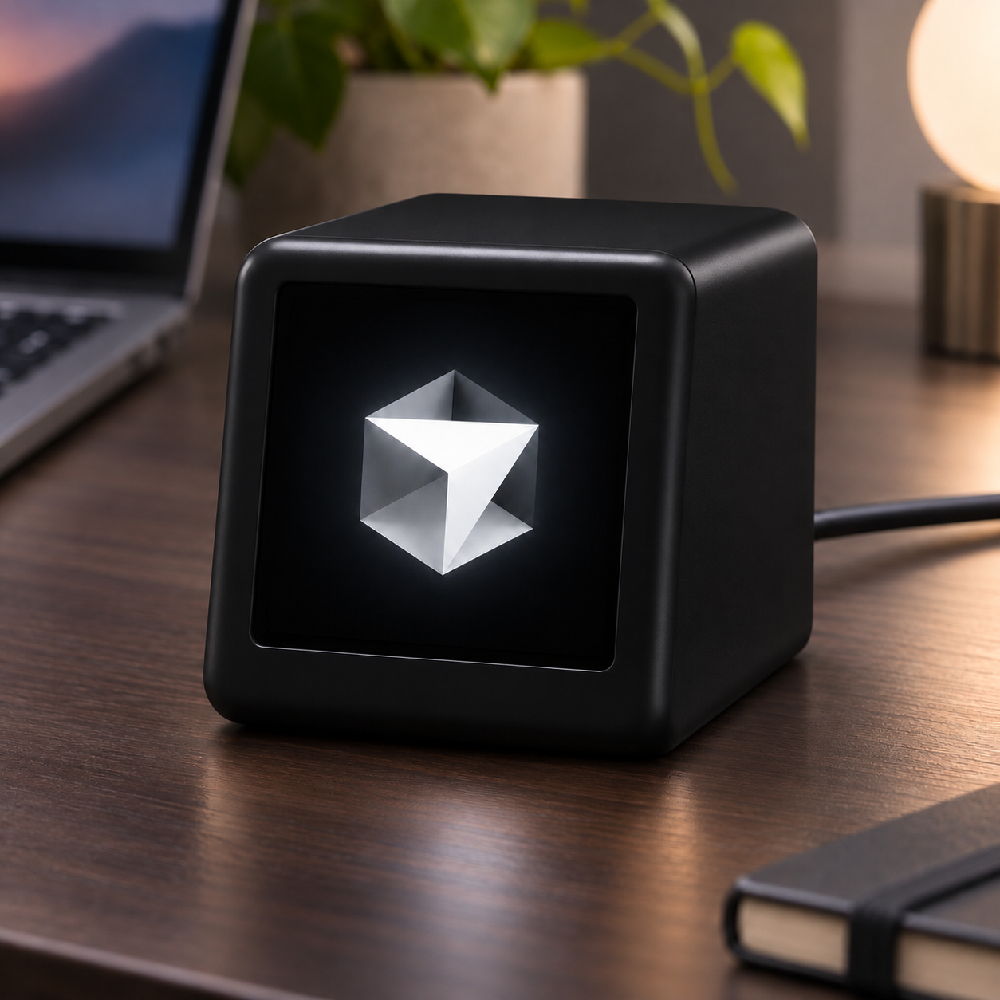

# macro-controller

A desk setup for Cursor: a 12-key, 3-knob macro pad for prompts and model switching, plus a small WiFi display that shows agent status live.

<p align="center">
  
</p>

```
Macro pad ──(USB key combos)──▶ Cursor keybindings
   ──▶ macropad extension (config/macropad.jsonc)
        ├── Cursor commands / terminals / git
        ├── Hammerspoon bridge ──▶ Cursor shortcuts
        └── display-bridge ──▶ WiFi clock (model / effort / context / branch)

Cursor hooks ──▶ display-bridge (launchd) ──▶ POST /state on the clock
```

| Folder            | What it is                                                                                                   |
| ----------------- | ------------------------------------------------------------------------------------------------------------ |
| `app/`            | **Macropad Studio** (Tauri + Vue + Tailwind). Edit keys, knobs, prompts, lighting; program the pad over USB. |
| `extension/`      | Cursor extension. Runs bindings, posts model/effort/window changes to the display bridge.                    |
| `shared/`         | TypeScript shared by the app, extension and scripts.                                                         |
| `config/`         | `macropad.jsonc` (bindings), `macropad.defaults.jsonc`, `device.jsonc` (layout, lighting).                   |
| `prompts/`        | Saved prompts as Markdown; file name is the prompt id.                                                       |
| `hammerspoon/`    | Localhost bridge that presses Cursor shortcuts for the extension.                                            |
| `display-bridge/` | Node daemon + Cursor hooks that push agent state to the desk display.                                        |
| `firmware/`       | ESP32-C2 firmware for the yellow AliExpress "Smart Weather Clock" (rescue + Cursor status UI).               |
| `docs/`           | USB protocol, key mapping, and display hardware notes.                                                       |
| `scripts/`        | `check.mjs` validates config; `generate.mjs` regenerates keybindings and docs.                               |
| `cursor/`         | Generated `keybindings.json` (synced into Cursor by the app).                                                |

---

## Parts of the system

### 1. Macro pad + Macropad Studio

The pad (model 12KV3) sends key combos into Cursor. The extension turns those into prompts, routines, git actions, and knob cycles (models, effort, send modes, branches).

Studio is the companion macOS app for editing everything without hand-editing JSONC.

### 2. Cursor status display

A cheap AliExpress WiFi weather clock (240×240 IPS, ESP8684 / ESP32-C2) runs custom firmware and shows:

- Active model and effort
- Agent state (thinking / working / idle / error)
- Segmented context bar (System, Tools, Rules, Skills, MCP, Agents, Summary, Chat) matching Cursor's own breakdown
- Project folder name and git branch
- Time, agent count

WiFi credentials stay out of git (`firmware/secrets.env`). Binaries are patched locally before OTA.

### 3. Display bridge

A launchd Node service on `127.0.0.1:47321` that:

- Receives observe-only Cursor hooks
- Reads exact context usage from Cursor's `state.vscdb` (read-only)
- Accepts instant model/effort updates from the macropad extension
- Posts JSON to the clock's `POST /state`

---

## Setup

### 1. Install Macropad Studio

```sh
cd app && npm install && npx tauri build
# .app: app/src-tauri/target/release/bundle/macos/Macropad Studio.app
# Dev: npx tauri dev
```

### 2. Install the extension

In Cursor: Command Palette → _Extensions: Install from VSIX…_ → `dist/macropad-0.2.0.vsix`.  
If you moved this folder, set `macropad.configPath` in Cursor settings.

### 3. Sync keybindings

Open Macropad Studio → **Cursor** tab → **Sync**. Merges macropad entries without touching your other shortcuts.

### 4. Install the Hammerspoon bridge

```sh
brew install --cask hammerspoon   # grant Accessibility permission
ln -s ~/Documents/WebProjects/macro-controller/hammerspoon/macropad.lua ~/.hammerspoon/macropad.lua
echo 'require("macropad")' >> ~/.hammerspoon/init.lua
```

Reload Hammerspoon. It creates `~/.macropad/token`. In Cursor run _Macropad: Test Hammerspoon bridge_.

### 5. Program the pad (optional)

USB → Studio → **Device** → **Program pad**. Lighting and startup animations are on the same tab / Pad paint mode.

### 6. Set up the desk display

One-time flash from stock firmware, then keep a rescue slot forever. Full steps: [`firmware/README.md`](firmware/README.md). Short version:

```sh
# secrets (2.4 GHz WiFi) — never commit
cp firmware/secrets.env.example firmware/secrets.env   # edit SSID/password

# first time: patch + OTA rescue into the stock slot
python3 firmware/tools/patch-wifi.py firmware/rescue/bin/clock_rescue.bin
curl -F "update=@firmware/rescue/bin/clock_rescue.patched.bin;filename=SDC2_rescue.bin" \
  http://192.168.0.89/update_ota

# back up 4 MB flash, then flash the display UI into the other slot
curl -o firmware/backup/flash-full.bin http://192.168.0.89/flash
python3 firmware/tools/patch-wifi.py firmware/display/bin/cursor_display.bin
curl --data-binary @firmware/display/bin/cursor_display.patched.bin \
  "http://192.168.0.89/ota?confirm=1"
```

Hardware notes, pinouts and flash layout: [`docs/cursor-display-device.md`](docs/cursor-display-device.md).

### 7. Install the display bridge

```sh
# edit display-bridge/config.json → "device": "http://<clock-ip>"
node display-bridge/install.mjs
curl -s 127.0.0.1:47321/state
tail -f ~/.cursor-display/bridge.log
```

Re-run `install.mjs` after changing the bridge. `--uninstall` removes hooks and the launchd service.

---

## Everyday use

### Pad

- **Bindings**: Studio → **Pad** → click a key or knob.
- **Prompts**: **Prompts** tab, or drop `.md` into `prompts/`. Variables: `{{file}}`, `{{selection}}`, `{{language}}`, `{{problems}}`, `{{clipboard}}`, `{{workspace}}`.
- **Send modes** (layer 2 middle knob): `paste`, `paste+send`, `newChat+send`.
- **Routines**: `steps` with `command`, `keys`, `terminal`, `shell`, `prompt`, `chat`, `delay`, `notify`.
- **Knob lists**: `cycles` from `prompts`, `sendModes`, `gitBranches`, or a custom `list`. Model and effort knobs update the desk display immediately.

### Desk display

What you see updates within about a second of Cursor activity. Useful endpoints on the clock:

| Endpoint         | Purpose                                         |
| ---------------- | ----------------------------------------------- |
| `GET /info`      | Firmware version, running slot, WiFi, heap      |
| `GET /state`     | Current on-screen state as JSON                 |
| `POST /state`    | Push state (normally done by the bridge)        |
| `POST /reboot`   | Soft reboot (plays the startup animation again) |
| `GET /lcd?bl=80` | Backlight / panel tweaks                        |

Safe OTA workflow when updating display firmware (always keep rescue reachable):

```sh
curl -X POST http://192.168.0.89/boot-other          # boot rescue in the other slot
# …upload new cursor_display.patched.bin via /ota?confirm=1…
```

---

## CLI workflow

```sh
cd extension && npm install && npm run compile
node scripts/check.mjs          # validate config
node scripts/generate.mjs       # regenerate keybindings + mapping doc
npm run package                 # → dist/macropad-0.2.0.vsix
```

Rebuild firmware (Docker, ESP-IDF v5.5.1, target `esp32c2`, 26 MHz XTAL):

```sh
docker run --rm -v "$PWD/firmware/display":/project -w /project \
  espressif/idf:v5.5.1 idf.py build
python3 firmware/tools/patch-wifi.py firmware/display/build/cursor_display.bin
```

---

## Safety notes

- Hammerspoon only listens on `127.0.0.1`, requires `~/.macropad/token`, and only presses keys while Cursor is frontmost. Prompt paste borrows the clipboard briefly and restores it.
- Display bridge hooks are observe-only: they never approve, block or delay the agent. Event logs store metadata only (no prompts or code); turn off with `"logEvents": false`.
- WiFi secrets are patched into firmware binaries locally; never commit `firmware/secrets.env` or `*.patched.bin`.
- After a display crash, the next boot enters safe mode (WiFi + OTA only) so you can flash a fix without unplugging. Power-cycle to try the display again.
- Stock firmware's `/scanwifi` can knock the device offline; don't call it.
